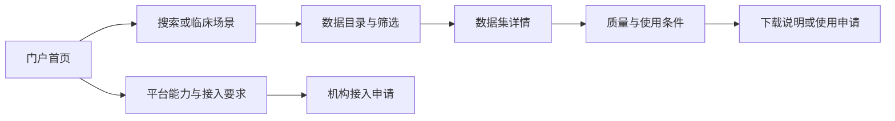

# BCI DataHub 门户 UI 与交互优化实施方案

编制日期：2026-11-16
适用范围：`frontend/web` 门户原型
当前阶段：首期交互原型已实施，真实服务接入待后续建设

## 1. 目标与依据

将门户建设为“以临床场景引导、以数据集为核心、以质量证据建立信任、以申请使用完成转化”的产品入口。

设计依据：

- `frontend/web/脑际接口高质量数据产品调研.html`：需求侧、供给侧、开放生态、数据治理与基础设施研究。
- `frontend/web/门户设计.html`：现有深蓝科技风门户及其内容、样式和交互脚本。

本方案基于上述文件的源码与内容分析，尚未进行浏览器实测。调研中的行业数字、临床成熟度和标准描述属于待核验的内容输入，不直接作为平台已具备能力或已通过认证的依据。

### 1.1 产品目标

让访问者能够完成四项判断：

1. 有没有适合自己研究任务的数据？
2. 数据质量、结构与适用限制是什么？
3. 可以通过什么方式使用，授权条件是什么？
4. 如何申请数据使用或机构接入？

### 1.2 实施边界

- 保留 BCI DataHub 品牌、深蓝基础配色和青蓝强调色。
- 首期交付可本地运行、可评审的 HTML 交互原型。
- 使用明确标识的模拟数据展示目录、质量报告和申请流程。
- 真实身份认证、权限控制、申请审批、数据下载、受控计算及模型服务列入后续接口接入范围。
- 保留原始调研页面，不将调研中的第三方资源规模写成平台自有资产。

## 2. 调研结论到产品设计的映射

| 调研方向 | 用户需求 | 门户设计动作 |
| --- | --- | --- |
| 临床任务决定需求优先级 | 按自己的问题寻找资源 | 提供病种、研究任务和模态入口 |
| 多中心、多模态提升数据价值 | 判断人群与场景覆盖 | 展示机构、受试者、会话、模态和随访信息 |
| 开放目录解决数据发现 | 快速定位可用数据 | 增加搜索、组合筛选、排序与详情 |
| 高质量数据支持实际使用 | 判断质量与适用限制 | 展示质量报告、标注协议及检查范围 |
| 基准评估支持复现 | 判断实验能否复用 | 展示任务、划分方式、版本与使用说明 |
| 分级共享与治理 | 理解访问边界 | 区分开放下载、申请访问和受控计算 |
| 长期演化的数据资产 | 跟踪数据变化 | 展示版本、更新时间与变更记录 |

## 3. 现状问题与处理优先级

| 编号 | 现状 | 用户影响 | 处理方式 | 优先级 |
| --- | --- | --- | --- | --- |
| UX-01 | 没有数据集目录与详情 | 无法判断是否有需要的资源 | 建立数据发现与详情流程 | P0 |
| UX-02 | 底部申请按钮返回页首，白皮书按钮跳转治理区 | 操作结果与预期不一致 | 替换为真实对应的原型交互或明确不可用状态 | P0 |
| UX-03 | 导航偏重治理和训练架构 | 用户难以找到任务入口 | 将数据资源前置 | P0 |
| UX-04 | 760px 以下隐藏导航且无替代菜单 | 移动端失去主要入口 | 增加菜单抽屉 | P0 |
| UX-05 | 静态面板展示实时同步、已通过校验及容量数字 | 演示内容被误解为实际运营状态 | 就近标明示例及口径 | P0 |
| UX-06 | 模态文字比例与动画宽度不一致 | 图表表达失真 | 统一数据来源与宽度计算 | P0 |
| UX-07 | 十类场景均为介绍卡片 | 阅读后没有下一步 | 场景联动数据筛选 | P0 |
| UX-08 | 高质量仅有能力描述 | 缺少选择数据的依据 | 增加质量报告和标注说明样例 | P1 |
| UX-09 | 临床成熟度标签过度简化 | 不能反映任务与技术路线差异 | 标注来源、日期和适用范围，区分资源开放状态 | P1 |
| UX-10 | 五层架构篇幅较大 | 技术细节抢占核心内容 | 首页概述，详情展开 | P1 |
| UX-11 | 内容默认透明，依赖脚本显示 | 脚本异常时正文可能不可见 | 改为渐进增强 | P0 |
| UX-12 | 辅助字号偏小，缺少减少动效适配 | 阅读与操作负担较高 | 统一排版、焦点和动效规则 | P0 |

P0 为首版完整体验所必需；P1 在核心流程稳定后补齐。

## 4. 用户与核心路径

| 用户 | 主要问题 | 核心路径 |
| --- | --- | --- |
| 医院、数据贡献机构 | 接入要求、治理过程、共享范围 | 平台能力 → 接入要求 → 机构接入申请 |
| 高校、科研人员 | 数据匹配度、质量、使用条件 | 搜索或场景 → 目录 → 详情 → 使用申请 |
| 算法、产业团队 | 格式、任务、授权与评估方式 | 模态或任务筛选 → 详情 → 使用说明 → 合作申请 |



## 5. 页面信息架构

### 5.1 顶部导航

数据资源｜临床场景｜平台能力｜标准与质量｜合作接入。

- 品牌标识返回首页。
- 首屏主操作为“浏览数据集”，次操作为“申请机构接入”。
- 具体数据集的使用申请从详情发起，自动带入资源与版本。
- 移动端以菜单按钮展开导航，支持关闭、Esc 和焦点返回。

### 5.2 首页模块顺序

| 顺序 | 模块 | 内容与交互 |
| --- | --- | --- |
| 1 | 首屏价值主张 | 服务对象、简明价值、搜索框、快捷标签、两个主次操作 |
| 2 | 精选数据资源 | 少量代表性数据卡片及完整目录入口 |
| 3 | 临床场景探索 | 优先展示运动康复、闭环调控、沟通替代，其他场景可展开 |
| 4 | 质量与可信使用 | 质量报告样例、版本信息、访问方式说明 |
| 5 | 平台能力 | 采集、治理、使用三个阶段及可展开的详细流程 |
| 6 | 开发与评估资源 | 格式说明、使用示例、评估介绍 |
| 7 | 合作接入 | 分角色介绍合作要求并进入对应申请流程 |

首屏右侧以精选数据集预览替代大幅装饰性资产面板。资源统计作为辅助信息，提供定义与更新时间。没有真实统计时明确使用示例数据。

## 6. 交互规格

### 6.1 搜索与数据目录

- 支持数据集名称、病种、任务和模态关键词搜索。
- 同一筛选维度内多选采用“或”，不同维度之间采用“且”。
- 基础筛选：病种、模态、研究范式、访问方式。
- 高级筛选：受试者规模、多中心、纵向随访、采样率等已有数据支持的字段。
- 展示匹配数量、已选条件、移除单项和清空操作。
- 支持相关度与最近更新排序；日期缺失时置后并明确展示。
- 将搜索、筛选、排序和页码保存在 URL 中，支持刷新、分享及浏览器前进后退。
- 从详情返回时恢复目录位置和筛选状态。
- 零结果时显示当前条件，提供清空或放宽条件入口。
- 数据加载失败时提供重试，不将失败显示为零结果。

### 6.2 数据卡片与详情

卡片优先显示名称、研究用途、病种、模态、受试者规模、版本和访问方式。

详情使用可直接访问的页面或路由视图，不使用承载全部长内容的弹窗。

| 详情区域 | 必备内容 |
| --- | --- |
| 概览 | 人群、任务、采集来源、覆盖范围、适用限制 |
| 数据结构 | 模态、通道、采样率、会话、标签及格式 |
| 质量说明 | 检查项目、指标定义、结果、缺失项和检查日期 |
| 使用条件 | 允许用途、访问方式、申请材料、许可说明 |
| 版本与引用 | 版本、变更记录、更新时间、引用信息 |

质量指标根据具体模态和任务展示，不生成没有定义依据的统一“质量总分”。数据未知时显示“未提供”，不以零代替。

详情主要操作与状态对应：

| 访问状态 | 操作 | 原型反馈 |
| --- | --- | --- |
| 开放资源 | 查看下载方式 | 提供有效资源链接或明确的演示说明 |
| 申请访问 | 申请使用 | 自动带入数据集 ID 与版本 |
| 受控计算 | 申请计算访问 | 解释访问方式并进入对应申请 |
| 暂未开放 | 查看开放说明 | 展示状态与可用联系方式，不伪造开放日期 |

### 6.3 临床场景联动

- 场景展示典型研究任务和相关模态。
- 点击“查看相关数据集”进入已应用场景条件的目录。
- 数据集数量由同一份目录数据计算。
- 无匹配资源时显示暂无资源，可进入需求登记流程。
- 应用成熟度与平台资源可用状态分别展示。
- 成熟度说明细化到任务或技术路线，提供来源与日期；尚未核验时不使用确定性认证式徽章。

### 6.4 平台能力与质量展示

- 保留六步治理链路，点击步骤展示输入、处理和产出。
- “清洗与质控”展示模拟报告，“标准化”展示结构示例，“发布”展示版本示例。
- 五层训练架构移至能力详情展开区，首页突出可获得的结果。
- 能力区分可体验、规划中和仅作概念说明等实际状态。
- 白皮书入口必须对应可用文件或内容页；尚无材料时显示明确状态。

### 6.5 申请流程

流程：选择需求 → 填写信息 → 核对 → 提交反馈。

| 申请类型 | 必要信息 |
| --- | --- |
| 机构接入 | 机构名称、机构类型、数据概况、合作意向、联系人及联系方式 |
| 数据使用 | 数据集与版本、机构、研究用途、使用范围、联系人及联系方式 |
| 计算访问 | 数据集与版本、研究任务、计算需求、机构及联系方式 |

- 每一步都有清晰标题和进度，允许返回修改并保留当前输入。
- 校验错误就近显示，提交时将焦点移至首个错误。
- 展示提交中、失败可重试与结果状态，防止重复提交。
- 原型反馈明确写明“演示提交，未发送”，不生成暗示真实受理的工单。
- 默认只在当前页面会话内保留表单，不将联系方式写入 URL 或持久存储。
- 后续真实接口接入后再展示服务端返回的申请编号与处理状态。

## 7. 视觉与响应式规范

### 7.1 视觉原则

- 保留深蓝背景和青蓝品牌色，使用清晰的内容表面层级。
- 青蓝强调色集中用于主要操作、选中状态和少量关键指标。
- 降低大面积渐变、光晕、持续闪烁及无意义悬浮效果。
- 不可操作内容不使用暗示点击的悬浮位移。
- 正文建议 14–16px，关键辅助信息尽量不低于 12px。
- 统一按钮、标签、输入框、提示、抽屉、弹窗及空状态组件。
- 图表长度与数值绑定同一数据字段，并说明统计口径；多模态可重叠时不默认呈现总和为 100% 的分布。

### 7.2 响应式与可访问性

- 桌面端目录采用筛选区域与结果区布局，移动端使用筛选面板。
- 在 375、768、1440px 代表性宽度验证布局与操作。
- 页面不产生非预期横向滚动，长表格可在自身容器内滚动。
- 按钮、导航与输入框具有可见焦点；状态信息不只依赖颜色。
- 弹层支持 Esc、焦点约束和关闭后焦点返回。
- 表单标签与输入控件关联，错误和动态反馈可被辅助技术读取。
- 遵循用户减少动态效果的偏好。
- 正文默认可见，动画作为增强，脚本异常不会隐藏页面主体。

## 8. 数据与技术组织

### 8.1 原型实现方式

沿用 HTML/CSS/JavaScript，避免在验证交互前引入不必要的应用框架。建议根据实际实现拆分为：

```text
frontend/web/
├── 脑际接口高质量数据产品调研.html   # 原始研究依据
├── 门户设计.html                   # 门户首页
├── 数据资源.html                   # 搜索与筛选
├── 数据集详情.html                 # 通过资源 ID 定位内容
└── assets/
    ├── portal.css                 # 共享视觉与响应式样式
    ├── portal.js                  # 导航、申请、通用交互
    ├── datasets.js                # 集中管理的示例资源
    └── catalog.js                 # 搜索、筛选及详情逻辑
```

目录结构为实施建议，第一阶段确认后按实际复杂度调整。通过本地静态 HTTP 服务预览，明确启动方法。

### 8.2 数据集字段

最小字段包括：

- 身份信息：`id`、名称、简介、版本、更新时间、示例标记。
- 发现字段：病种、任务、范式、模态、关键词。
- 规模字段：受试者数、会话数、信号小时数、中心数及各自统计口径。
- 结构字段：格式、通道、采样率、标签、随访信息。
- 质量字段：报告、指标定义、检查范围、检查时间与限制。
- 访问字段：访问方式、许可说明、使用限制、资源链接。
- 溯源字段：提供方、来源、引用与变更记录。

首页统计、卡片、筛选结果与详情共用数据，避免多个页面手写同一指标导致不一致。

### 8.3 后续接口需求

真实接入阶段需要明确目录查询、详情、质量报告、身份状态、申请提交、申请查询和授权资源访问接口。前端不得承担权限判定的最终责任。

接口接入前冻结字段定义、分页规则、错误结构和申请状态。接口不存在时仅展示原型状态，不伪造实时服务结果。

## 9. 分阶段实施清单

| 阶段 | 任务 | 交付物 | 完成条件 |
| --- | --- | --- | --- |
| A：内容与结构 | 梳理来源、统一术语与状态、确定页面结构和字段 | 内容映射表、页面结构、数据模型 | 每个主入口都有目的地，每个指标有口径或示例标识 |
| B：视觉基础 | 建立样式变量与公共组件，重构首屏、导航和移动菜单 | 首页及基础组件 | 主操作可达，移动端有完整导航 |
| C：核心流程 | 完成目录、组合筛选、详情、场景联动和申请 | 可操作的核心原型 | 找数据、看详情、模拟申请可连续完成 |
| D：可信内容 | 增加质量、版本、治理展开及开发资源 | 质量与能力内容 | 用户能够判断数据用途、限制和使用方式 |
| E：验证交付 | 验证链接、状态、响应式、键盘、数据一致性 | 验收记录、修复记录、预览说明 | P0 问题全部关闭，P1 遗留项有明确说明 |

依赖顺序为 A → B → C → D → E。无后端接口不阻塞原型交付，但真实申请与授权能力须单独验收。

## 10. 验收用例

| 编号 | 操作 | 预期结果 |
| --- | --- | --- |
| AC-01 | 首页搜索“运动想象” | 进入目录并保留关键词，结果与示例数据一致 |
| AC-02 | 同时选择病种、EEG 和访问方式 | 按约定组合规则返回结果并显示条件 |
| AC-03 | 进入详情后返回 | 条件、排序、页码和列表位置恢复 |
| AC-04 | 点击临床场景 | 进入匹配目录，数量与资源数据一致 |
| AC-05 | 使用无匹配条件 | 显示零结果及调整入口，不出现虚构资源 |
| AC-06 | 查看未知 ID 或加载失败 | 分别显示不存在或加载错误及恢复入口 |
| AC-07 | 从详情申请使用 | 自动带入资源与版本，错误字段可定位 |
| AC-08 | 完成原型申请 | 明确提示演示提交未发送，不暗示真实受理 |
| AC-09 | 检查所有主按钮和白皮书入口 | 名称与结果一致，不使用无关锚点占位 |
| AC-10 | 对照图表、数字和详情 | 指标来自同一数据源，口径明确 |
| AC-11 | 在代表性屏宽操作 | 菜单、筛选、详情和申请均可使用，无内容被固定导航遮挡 |
| AC-12 | 仅使用键盘操作 | 焦点可见、顺序合理、弹层可关闭并返回焦点 |
| AC-13 | 开启减少动态效果或阻断脚本 | 减少动画，正文仍可阅读，必要时说明交互不可用 |
| AC-14 | 检查示例与能力声明 | 示例就近标识，规划能力未被表述为已上线 |

验证采用浏览器实际操作、关键流程自动化和必要的截图对照。自动化优先覆盖组合筛选、URL 状态恢复、详情关联及申请校验，不为纯装饰性样式编写实现镜像测试。

## 11. 内容依赖与实施假设

| 依赖 | 原型阶段处理 | 正式上线前要求 |
| --- | --- | --- |
| 真实数据资源清单 | 使用显式标识的示例数据 | 由资源负责人提供并确认 |
| 平台规模与质量结果 | 使用示例或显示未提供 | 有明确统计口径和可追溯结果 |
| 临床成熟度、标准信息 | 对照调研记录待核验项 | 补充可靠来源、日期与适用范围 |
| 联盟身份与合作关系 | 不将调研对象直接表述为本平台关系 | 确认可公开的合作信息 |
| 白皮书与开发文档 | 提供真实原型说明或不可用状态 | 补齐对应文件及有效链接 |
| 申请受理服务 | 本地模拟，不发送个人信息 | 完成接口、状态和失败恢复验证 |

首版以“首页重排、数据目录与详情、场景联动、申请闭环、移动端导航”为主要交付范围，随后补齐质量证据、版本和平台能力展开。完成原型验收后，再推进真实服务接入。

## 12. 首期执行结果（2026-11-16）

- 已交付门户首页、数据资源目录、数据集详情、使用指南及共享交互组件。
- 已完成搜索、组合筛选、规模与采样率条件、排序、分页、URL 恢复、场景跳转及申请演示闭环。
- 已完成质量报告示例、版本与使用条件、六步治理展开及移动导航。
- 已生成独立五层技术架构 SVG 与 PNG，并嵌入首页，展示核心模块、接口契约、层间制品与贯穿治理能力。
- 原始门户保留于 `frontend/web/门户设计-原始参考.html`；原始调研未修改。
- 运行与验证方式见 `frontend/web/README.md`；验收范围见 `frontend/web/验收记录.md`。
- 当前仅为前端原型；真实数据、认证授权、审批及计算服务仍按本方案第 8、11 节单独接入与验收。
